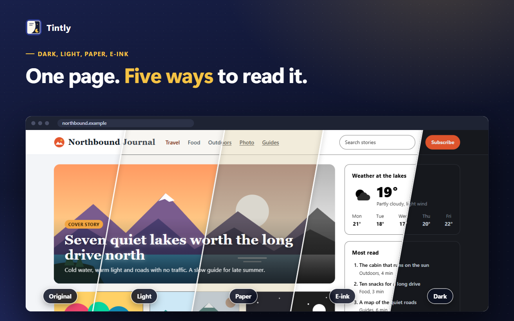
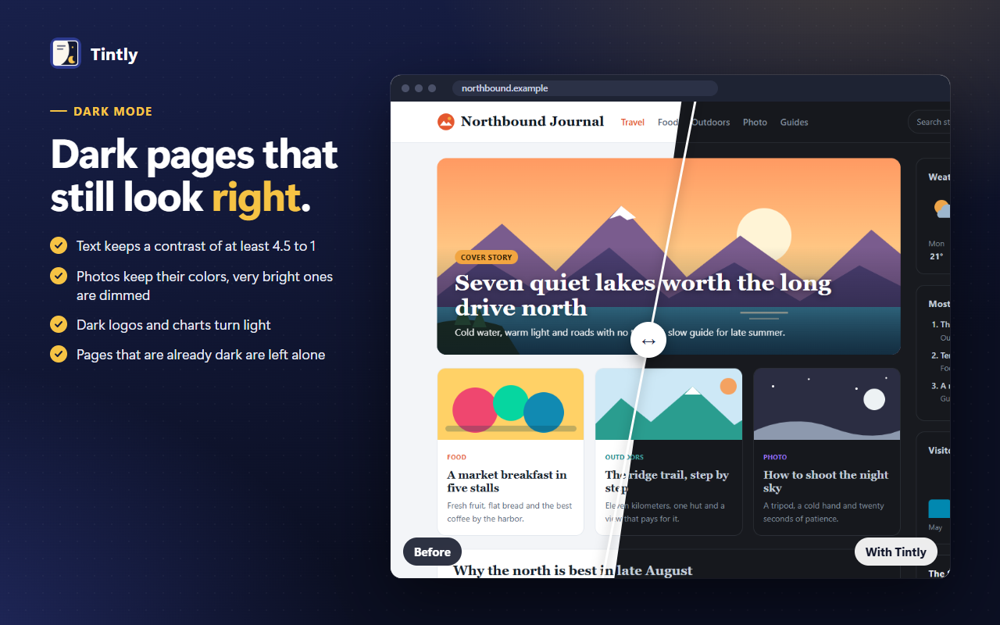
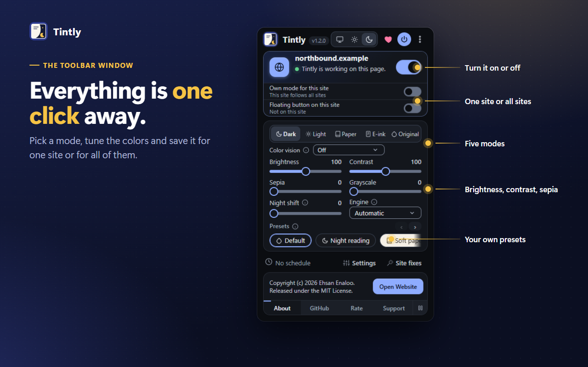
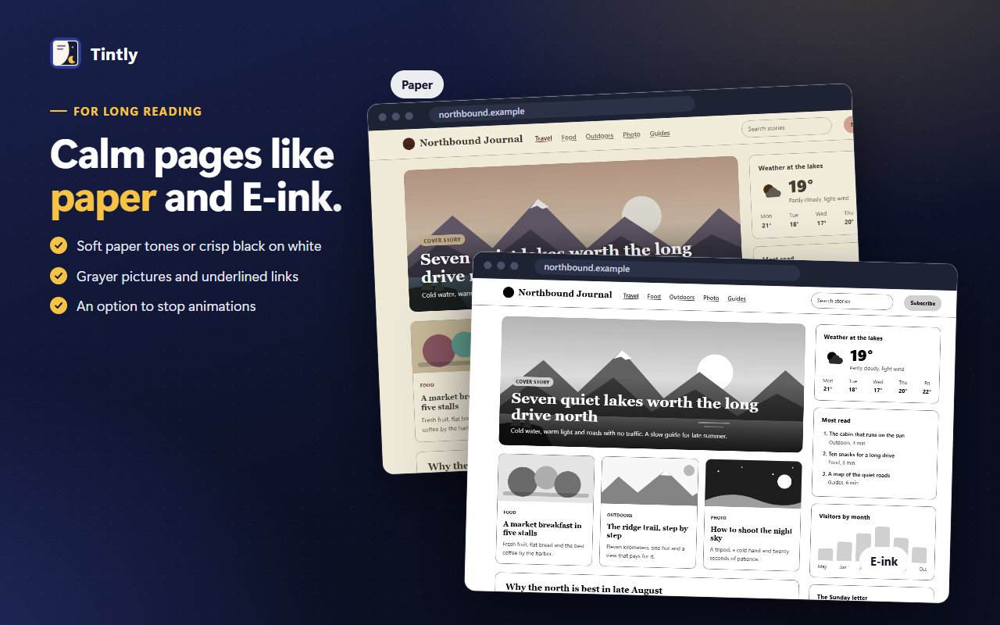
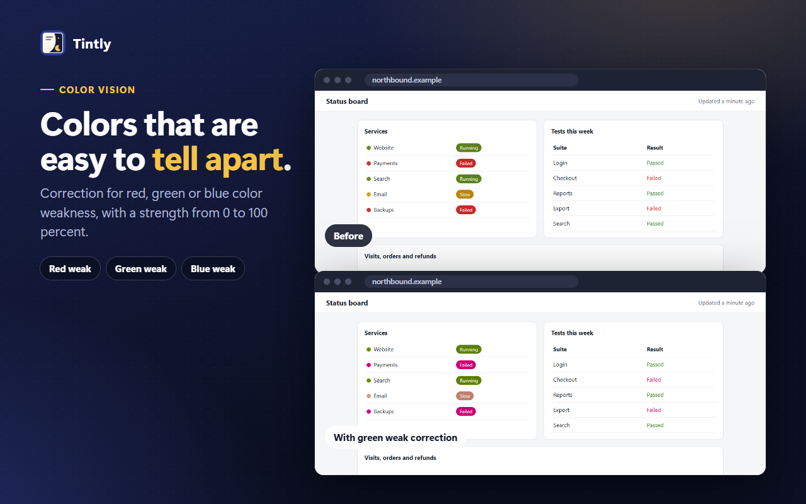
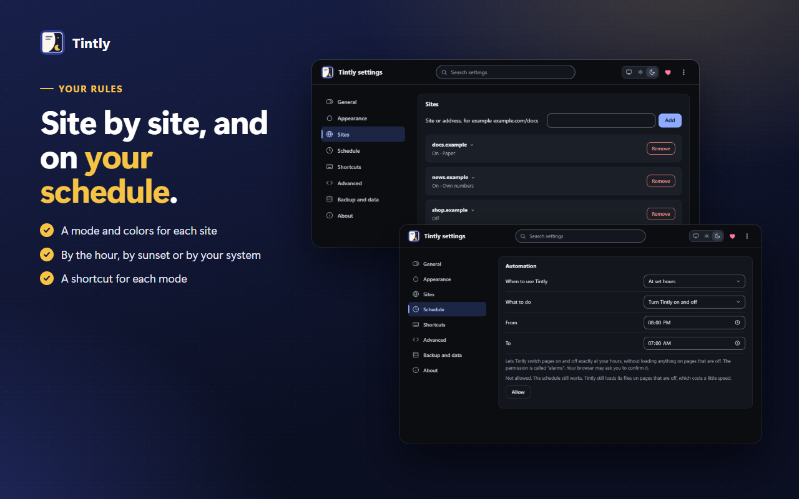
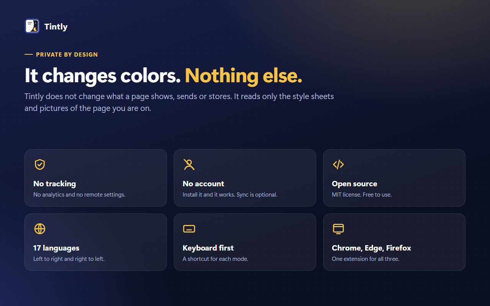

[English](../README.md) | [فارسی](README.fa.md) | [العربية](README.ar.md) | **עברית**

# Tintly

**דפי אינטרנט שנוחים לעיניים שלכם.**

בחרו לכל דף מראה כהה, בהיר, דמוי נייר או אפור בסגנון E-ink. אם קשה לכם להבחין בין אדום לירוק, Tintly עוזר להבליט את ההבדל ביניהם. הגדירו כל אתר פעם אחת, וההגדרות יישמרו לביקורים הבאים. הכול נעשה במכשיר שלכם.

## למה Tintly

לרוב דפי האינטרנט יש רקע לבן, שעלול לסנוור בלילה ולעייף בקריאה ממושכת. עבור כאחד מכל שנים עשר גברים, גם ההבחנה במידע מסוים עלולה להיות קשה: הודעת שגיאה באדום לצד הודעת "הושלם" בירוק, או שני קווים בגרף שנראים באותו צבע.

Tintly משנה את צבעי הדף בלי לשנות את המבנה או את התוכן. במקום להפוך את כל הצבעים באופן גורף, הוא קורא את קובצי ה-CSS של הדף ומתאים להם צבעים חדשים. כך תמונות, סמלי מותג וגרפים שומרים על מראה תקין, וגם דפים גדולים נשארים מהירים.

---

## חמישה מצבי תצוגה

מחליפים מצב בלחיצה אחת, בחלון התוסף שבסרגל הכלים של הדפדפן.

| מצב | מתאים ל | מה מקבלים |
|---|---|---|
| **כהה** | שעות הערב, חדרים עם תאורה חלשה, מסכי OLED | ערכת נושא כהה עם שבע פלטות: Default, Graphite, AMOLED black, Midnight blue, Solarized Dark, Nord ו-Gruvbox. הניגודיות של הטקסט נשארת תמיד לפחות 4.5 ל-1 |
| **בהיר** | חדרים מוארים, קריאה ביום | ערכת נושא בהירה ונקייה עם ארבע פלטות: Default, Warm paper, Cool gray ו-High contrast |
| **נייר** | קריאה ארוכה בכל מסך | רקע בגוון נייר חמים וטקסט בגוון עדין יותר, עם פחות לובן בוהק ופחות אור כחול, למראה המזכיר דף מודפס |
| **E-ink** | צמצום הסחות חזותיות, מסכים בשחור-לבן | נייר לבן, דיו שחור ו-8 גווני אפור. תמונות הופכות לאפורות. אנימציות, צללים וגלילה חלקה נעצרים |
| **צבעים מקוריים** | שמירה על הצבעים של הדף עצמו | Tintly משאיר את הצבעים כפי שהם ומחיל רק את מה שבחרתם, כמו התאמת צבעים לעיוורון צבעים או הוספת קו תחתון לקישורים |

במצבים כהה ובהיר אפשר לכוונן את הבהירות, הניגודיות, גוון הספיה, גווני האפור וחמימות הצבעים בלילה (Night Shift) באמצעות מחוונים.

---

## התאמת צבעים לעיוורון צבעים

**אם קשה לכם להבחין בין אדום לירוק, Tintly עוזר להבליט את ההבדל ביניהם.**

לכ-8 אחוזים מהגברים ולכ-0.5 אחוזים מהנשים יש סוג כלשהו של עיוורון צבעים, אבל דפי אינטרנט רבים אינם מותאמים לכך. חיוויי מצב, גרפים, מפות, תצוגות השוואת קוד והודעות שגיאה מסתמכים על צבעים שעלולים להיראות זהים.

Tintly מתאים את צבעי הדף עצמו, כך שאין צורך באתר מיוחד או בכלי לצילום מסך.

- **בחרו את סוג עיוורון הצבעים.** רגישות מופחתת לאדום (Protan), לירוק (Deutan) או לכחול (Tritan).
- **כוונו את העוצמה.** בחרו ערך בין 0 ל-100 אחוז, לפי מידת הקושי בהבחנה בצבעים.
- **קבעו כמה הצבעים ישתנו.** המחוון "חיזוק צבע" שולט במידת השינוי של צבעים עדינים וחזקים.
- **בדקו את התוצאה מראש.** שורת התצוגה המקדימה מציגה צבעים נפוצים לפני החלת המסנן ואחריה, לצד הדמיה של האופן שבו הם עשויים להיראות עם סוג עיוורון הצבעים שבחרתם.
- **שמירה על הבהירות.** שחור, לבן ואפור נשארים ללא שינוי, והצבעים שומרים על מידת הבהירות או הכהות שלהם. במצב של רגישות מופחתת לאדום, גוני האדום מובהרים כדי שייראו בבהירות המתאימה.
- **החלה גם על מדיה.** אותו מסנן חל גם על תמונות, סרטונים, סמלים ותמונות רקע. אפשר לכבות את האפשרות הזאת.
- **שילוב עם מצבי התצוגה.** השתמשו במסנן עם מצב כהה, בהיר או נייר, או לבדו במצב "צבעים מקוריים", כדי לשמור על מראה הדף ולשנות רק צבעים שקשה להבחין ביניהם.
- **קו תחתון לקישורים.** זהו קישורים בלי להסתמך על הצבע שלהם.
- **הגדרות לכל אתר.** בחרו מסנן ועוצמה נפרדים לכל אתר.

ברשימת המסננים זמינות גם האפשרויות "גווני אפור", "גווני אפור הפוכים" ו"צבעים הפוכים", למי שמעדיפים מראה כזה.

---

## מיועד לקריאה

מצבי "נייר" (Paper) ו-E-ink מתאימים דפים עמוסים לקריאה נוחה יותר, במראה המזכיר ספר.

- בחרו צבע נייר מתוך האפשרויות המוכנות: קרם (Cream), צהוב עדין (Soft yellow), אפור בהיר (Light gray) ולבן (White).
- כוונו את רמת הבהירות המרבית של הלבן והפחיתו אור כחול לקריאה בשעות הערב המאוחרות.
- הציגו תמונות בהתאם להגדרת הצבע, בגווני אפור או בצבעים המקוריים שלהן.
- בחרו אם לעבות את גבולות הכפתורים ושדות הקלט ואת מסגרת המיקוד של המקלדת.
- בחרו מעבר רציף בין גווני אפור, או הגבילו את התצוגה ל-2, 4, 8 או 16 גוונים.
- כבו הנפשות, מעברים, גלילה חלקה וצללים, כל אחד בנפרד.

---

## התאמות חכמות לתצוגה

| תכונה | איך זה עובד |
|---|---|
| **ארבעה מנועים** | המנוע "דינמי" קורא את קובצי ה-CSS ומחיל צבעים חדשים. "מסנן" ו"מסנן+" פועלים מיד ומתאימים לדפים גדולים במיוחד. המנוע "סטטי" משנה צבעים רק באזורים שצוינו בתיקון שמור. האפשרות "אוטומטי" בוחרת עבורכם את המנוע המתאים |
| **ערכת הנושא הכהה של האתר** | אם לדף יש ערכת נושא כהה משלו, Tintly מפעיל אותה ובודק את התוצאה. דפים שכבר מוצגים במצב כהה נשארים ללא שינוי |
| **שמירה על מראה התמונות** | הצבעים של סמלי מותג וגרפים כהים על רקע לבן מתהפכים, ותמונות בהירות מאוד מוחשכות מעט. הרקע של קודי QR נשאר לבן כדי לשמור על אפשרות הסריקה |
| **מניעת הבהוב לבן** | מראה כהה ראשוני מוצג עד להשלמת הטעינה של ערכת הנושא |
| **טקסט קריא** | ניגודיות הטקסט נשמרת לאחר החלת ערכת הנושא |

---

## בשליטתכם

- **הגדרות נפרדות לכל אתר.** הפעילו או כבו את Tintly באתר מסוים, ובחרו עבורו מצב תצוגה, מנוע והגדרות משלו. אפשר גם להפעיל את התוסף רק באתרים שתבחרו.
- **תזמון.** קבעו שעות פעילות, התאימו את ההפעלה לשקיעה ולזריחה באזורכם, או פעלו לפי המצב הכהה של המערכת.
- **הגדרות שמורות.** שמרו את המראה המועדף עליכם והחילו אותו שוב בלחיצה אחת.
- **תיקונים לאתרים.** הוסיפו CSS מותאם לאתר, סמנו סמלי מותג שצריך להפוך את צבעיהם, והשאירו צבעים או תמונות מסוימים ללא שינוי. אפשר להעתיק תיקון או להוסיף תיקון שכתבו אחרים.
- **גיבוי וסנכרון.** ייצאו את ההגדרות וייבאו אותן בעת הצורך. סנכרון דרך חשבון הדפדפן הוא לבחירתכם וכבוי כברירת מחדל.
- **תמיכה במקלדת.** השתמשו ב-`Alt+Shift+D` להפעלה או לכיבוי של התוסף, וב-`Alt+Shift+S` עבור האתר הנוכחי. כל החלונות ניתנים לשימוש במקלדת ומכבדים את הגדרות הפחתת התנועה והצבעים הכפויים של המערכת.

---

## צילומי מסך

<table>
  <tr>
    <td width="50%"></td>
    <td width="50%"></td>
  </tr>
  <tr>
    <td width="50%"></td>
    <td width="50%"></td>
  </tr>
  <tr>
    <td width="50%"></td>
    <td width="50%"></td>
  </tr>
</table>

---

## פרטיות כחלק מהתכנון

- Tintly אינו אוסף נתונים: אין טלמטריה, אין ניתוח נתוני שימוש, אין חשבון משתמש ואין הגדרות המנוהלות מרחוק.
- ההגדרות, כללי האתרים, ההגדרות השמורות והתיקונים נשארים בדפדפן שלכם.
- בקשות הרשת היחידות נועדו להורדת קובץ CSS או תמונה מהדף הנוכחי, כאשר הדפדפן אינו מאפשר לקוד הדף לקרוא אותם ישירות. לא נשלחות עוגיות עם הבקשות האלה.
- התוסף משנה צבעים, גופנים ואת הערך `color-scheme`, בלי לשנות את התוכן או את הנתונים שהדף מציג, שולח או שומר. Tintly אינו מתערב באתרים שבהם כיביתם אותו.

| הרשאה | למה היא נדרשת |
|---|---|
| `storage` | לשמירת ההגדרות שלכם |
| `scripting` | להוספת מנוע שינוי הצבעים לדפים שאתם פותחים |
| גישה לכל האתרים | לשינוי צבעי הדפים שאתם פותחים |
| `contextMenus`, רשות | להוספת אפשרות לתפריט הלחיצה הימנית, רק אם הפעלתם אותה |
| `alarms`, רשות | להפעלה ולכיבוי לפי לוח הזמנים שהגדרתם, רק באישורכם |

הנוסח המלא: [מדיניות הפרטיות](../docs/PRIVACY.md) (באנגלית).

---

## התקנה

| דפדפן | גרסה מינימלית | איך |
|---|---|---|
| Chrome ו-Edge | 119 | התקינו מ-Chrome Web Store או מ-Edge Add-ons. כדי להריץ את קוד המקור, שכפלו את המאגר, פתחו את `chrome://extensions`, הפעילו Developer mode ולחצו **Load unpacked**. בחרו את התיקייה `extension/` |
| Firefox | 128 | התקינו מ-Firefox Add-ons. Firefox צריך חבילה משלו, ומתחזק הפרויקט בונה אותה מהתיקייה `extension/` |

---

## שפות

הממשק זמין באנגלית, בפרסית, בערבית, בעברית, בספרדית, בפורטוגזית (ברזיל), ברוסית, בגרמנית, בצרפתית, בסינית (מפושטת), בסינית (מסורתית), בקוריאנית, ביפנית, בהינדית, באינדונזית, באיטלקית ובטורקית. בפרסית, בערבית ובעברית, פריסת החלון כולו מותאמת לכיוון הכתיבה מימין לשמאל. כדי לתקן טקסט או להוסיף שפה, קראו את [TRANSLATING.md](../docs/TRANSLATING.md) (באנגלית) או השתמשו ב[טופס תיקון תרגום](https://github.com/ehsanenaloo/Tintly/issues/new?template=translation_fix.yml).

כל התרגומים חוץ מהאנגלית הם תרגומי מכונה, ועדיין אף דובר שפת אם לא בדק אותם. אם אחת השפות האלה היא שפת האם שלכם ושיפרתם את הטקסטים, נפרסם את העבודה בשמכם. התחילו מ-[TRANSLATING.md](../docs/TRANSLATING.md) (באנגלית) או מטופס תיקון התרגום.

---

## הערות לבעלי אתרים

- בקשו מ-Tintly להשאיר את הדף שלכם כפי שהוא באמצעות `<meta name="tintly" content="off">` או `<html data-tintly="off">`.
- הוסיפו לאתר ערכת נושא כהה: הגדירו `color-scheme: light dark` ואת צבעי הערכה הכהה בתוך `@media (prefers-color-scheme: dark)`. Tintly יפעיל את הערכה אם הדף כהה והטקסט קריא.
- אם הדף שלכם תומך בסכמת צבעים אחת בלבד, הצהירו על כך עם `color-scheme: only light` או `only dark`, ו-Tintly יכבד זאת. מבקר עדיין יכול להפעיל את Tintly באתר ידנית.

---

## שאלות נפוצות

**האם Tintly שולח את הנתונים שלי למקום כלשהו?** לא. ראו [פרטיות כחלק מהתכנון](#פרטיות-כחלק-מהתכנון).

**יש בעיה בתצוגה של דף. מה אפשר לעשות?** נסו מנוע אחר בחלון התוסף, או כבו את Tintly עבור האתר. לאחר מכן מלאו את [הטופס לדיווח על בעיית תצוגה](https://github.com/ehsanenaloo/Tintly/issues/new?template=site_breakage.yml), וציינו את כתובת הדף, מצב התצוגה והמנוע שבחרתם.

**מה ההבדל בין "נייר" ל-E-ink?** שניהם מיועדים לקריאה נוחה. במצב E-ink התצוגה נטולת צבע כברירת מחדל. מצב "נייר" שומר על מעט צבע ומפחית את הלובן הבוהק ואת האור הכחול. בשני המצבים אפשר לשנות זאת דרך הגדרת הצבע.

**אפשר להשתמש ב-Tintly רק באתרים מסוימים?** כן. אפשר להפעיל אותו רק באתרים שתבחרו, או לכבות אותו באתרים מסוימים בנפרד.

---

## פיתוח

אין שלב בנייה ואין צורך להתקין דבר. טענו את התיקייה `extension/` ב-Chrome או ב-Edge כמו שמוסבר ב[התקנה](#התקנה), בצעו את השינוי ולחצו על כפתור הטעינה מחדש של התוסף. מתחזק הפרויקט מריץ את הבדיקות ובונה את החבילות לחנויות. פרטים נוספים ב-[ARCHITECTURE.md](../docs/ARCHITECTURE.md) וב-[CONTRIBUTING.md](CONTRIBUTING.md) (באנגלית).

---

## תיעוד

| | |
|---|---|
| [מדריך למשתמש](https://enaloo.com/apps/tintly/) | כל התכונות וההגדרות (באנגלית) |
| [מדיניות פרטיות](../docs/PRIVACY.md) | מה נקרא, נשמר ונשלח |
| [תרגום](../docs/TRANSLATING.md) | איך מתקנים טקסט או מוסיפים שפה (באנגלית) |
| [ארכיטקטורה](../docs/ARCHITECTURE.md) | מנועים, סביבות הרצת קוד, שירות הרקע וזרימת הנתונים |
| [יומן שינויים](../CHANGELOG.md) | מה השתנה |
| [תרומה](CONTRIBUTING.md) | הכנה, כללים, תיקונים ותרגומים |
| [תמיכה](SUPPORT.md) | דרכים לקבלת עזרה |
| [אבטחה](SECURITY.md) | דיווח על פרצה |

---

## תרומה

נשמח לקבל דיווחי באגים, דיווחים על בעיות בתצוגת דפים, תיקוני תרגום ובקשות מיזוג קטנות. קראו תחילה את [מדריך התרומה](CONTRIBUTING.md). השתתפות בפרויקט פירושה הסכמה ל[כללי ההתנהגות](CODE_OF_CONDUCT.md).

- **דווחו על בעיות בתצוגת דפים.** השתמשו בטופס המתאים וציינו את כתובת הדף, מצב התצוגה והמנוע שבחרתם.
- **עזרו לשפר את הניסוח.** נשמח להצעות לשיפור הטקסטים בפרסית, בערבית ובעברית.
- **סמנו את המאגר בכוכב אם הוא מועיל לכם.** כך תעזרו לאחרים למצוא אותו.

אם Tintly הופך את הקריאה לנוחה יותר לעיניים שלכם, אפשר [לתמוך בפרויקט](https://enaloo.com/support/). התמיכה היא לבחירתכם בלבד ואינה משפיעה על הטיפול בדיווחים.

על בעיות אבטחה יש לדווח באופן פרטי, לפי ההנחיות ב-[SECURITY.md](SECURITY.md).

### תורמים

תודה לכל מי שסייע לפרויקט. שמכם יופיע כאן לאחר שהתרומה הראשונה שלכם תתקבל ותמוזג.

---

## רישיון

Copyright (c) 2026 Ehsan Enaloo. Released under the [MIT License](../LICENSE).

## על הפרויקט

פותח על ידי [Ehsan Enaloo](https://github.com/ehsanenaloo). Tintly הוא תוסף ל-Chrome, ל-Edge ול-Firefox, עם מצבי תצוגה כהה, בהיר, נייר ו-E-ink, התאמות לעיוורון צבעים והגדרות נפרדות לכל אתר.

