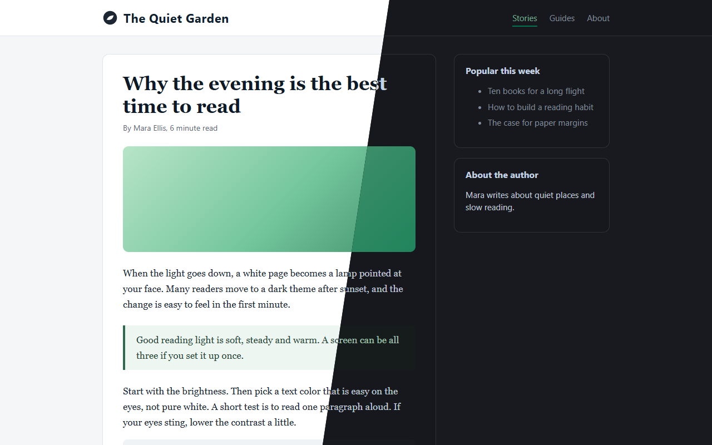
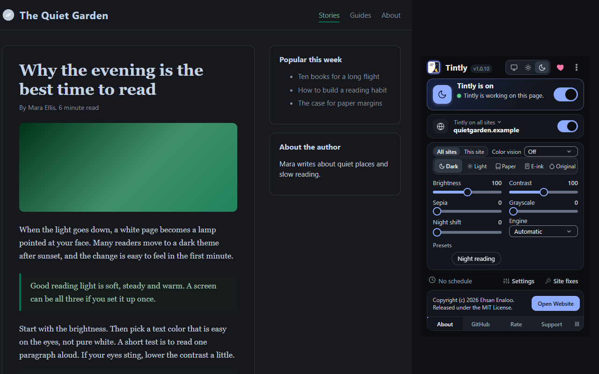
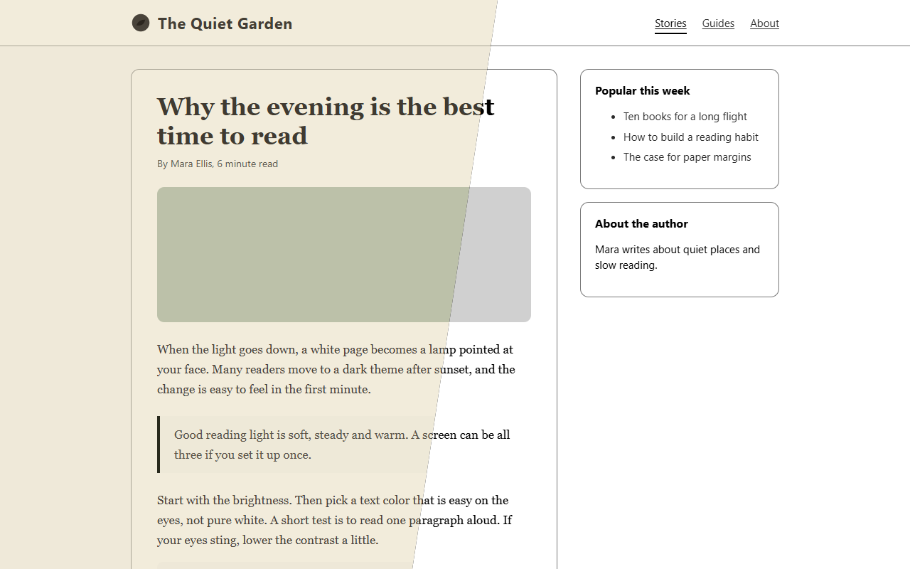
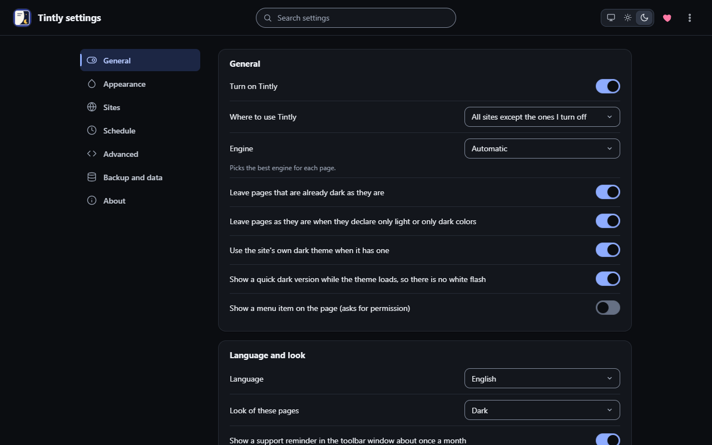

<div align="center" dir="rtl">

[English](../README.md) | [فارسی](README.fa.md) | [العربية](README.ar.md) | **עברית**

<a href="https://enaloo.com/apps/tintly/"></a>

# Tintly

**דפי אינטרנט בגודל העיניים שלכם.**

הפכו כל דף לכהה, לבהיר, לדף נייר או לאפור בסגנון E-ink. הרחיקו זה מזה צבעים שנראים לכם זהים, כמו אדום וירוק. הגדירו פעם אחת לכל אתר ושכחו מזה. הכול נשאר במכשיר שלכם.

[](https://enaloo.com/apps/tintly/)
[](https://buymeacoffee.com/enaloo)

[](https://github.com/ehsanenaloo/Tintly/actions/workflows/ci.yml)
[](https://github.com/ehsanenaloo/Tintly/releases)
[](../extension/manifest.json)
[](#התקנה)
[](#שפות)
[](#פרטיות-מעיקרה)
[](../LICENSE)
[](https://github.com/ehsanenaloo/Tintly/stargazers)

<a href="https://enaloo.com/apps/tintly/"></a>

</div>

<div dir="rtl">

## למה Tintly

רוב האינטרנט הוא מסך לבן. בלילה הוא מסנוור. בקריאה ארוכה הוא מעייף. ועבור גבר אחד מכל שנים עשר בערך הוא גם מסתיר מידע: שגיאה באדום ליד "הושלם" בירוק, או גרף עם שני קווים שנראים באותו צבע.

Tintly משנה את הצבעים של כל דף שאתם פותחים ומשאיר את הפריסה והתוכן כפי שהם. הוא לא הופך צבעים באופן עיוור. הוא קורא את גיליונות הסגנון של הדף וכותב להם צבעים חדשים. לכן תמונות, לוגואים וגרפים נשארים תקינים, ודפים גדולים נשארים מהירים.

---

## חמש דרכים לראות דף

פקד אחד בחלון סרגל הכלים. לחיצה אחת להחלפה.

| מצב | מתאים ל | מה מקבלים |
|---|---|---|
| **כהה** | ערבים, חדרים עמומים, מסכי OLED | ערכת נושא כהה עם שבע פלטות: Default, Graphite, AMOLED black, Midnight blue, Solarized Dark, Nord ו-Gruvbox. הניגודיות של הטקסט נשארת תמיד לפחות 4.5 ל-1 |
| **בהיר** | חדרים מוארים, קריאה ביום | ערכת נושא בהירה ונקייה עם ארבע פלטות: Default, Warm paper, Cool gray ו-High contrast |
| **נייר** | קריאה ארוכה בכל מסך | צבע נייר חם, דיו רך, פחות לבן ופחות אור כחול. דף רגוע שמרגיש כמו דפוס |
| **E-ink** | שקט מרבי, מסכים בשחור-לבן | נייר לבן, דיו שחור ו-8 גווני אפור. תמונות הופכות לאפורות. אנימציות, צללים וגלילה חלקה נעצרים |
| **צבעים מקוריים** | שמירה על הצבעים של הדף עצמו | Tintly משאיר את הצבעים כפי שהם ומחיל רק את מה שבחרתם, כמו תיקון ראיית צבעים או קו תחתון לקישורים |

במצבים כהה ובהיר, מחוונים לבהירות, ניגודיות, ספיה, גווני אפור ומשמרת לילה מכוונים את המראה בדיוק רב יותר.

---

## תיקון ראיית צבעים

**אם אדום וירוק נראים לכם דומים, Tintly מרחיק אותם זה מזה.**

כ-8 אחוזים מהגברים וחצי אחוז מהנשים סובלים מסוג כלשהו של עיוורון צבעים. לדף אינטרנט זה לא אכפת. נורות סטטוס, גרפים, מפות, הבדלי קוד והודעות שגיאה נשענים על צבעים שעלולים להיראות זהים.

Tintly משנה את הצבעים של הדף עצמו, כך שאין צורך באתר מיוחד או בכלי צילום מסך.

- **בחרו את הסוג שלכם.** חולשה באדום (Protan), חולשה בירוק (Deutan) או חולשה בכחול (Tritan).
- **קבעו את העוצמה.** מ-0 עד 100 אחוז, לצורה קלה או חזקה.
- **קבעו עד כמה הצבעים יזוזו.** המחוון "חיזוק צבע" מחליט כמה ישתנו צבעים עדינים וצבעים חזקים.
- **ראו לפני שמחליטים.** שורת תצוגה מקדימה מציגה צבעים נפוצים כפי שהם בדף ואחרי המסנן, וכיצד אדם מהסוג שלכם עשוי לראות כל אחד מהם.
- **הבהירות נשמרת.** אפור, שחור ולבן נשארים כפי שהם, וכך גם מידת הבהירות או הכהות של כל צבע. בחולשה באדום האדומים מוארים מעט כדי שייראו בבהירות שמגיעה להם.
- **הכול מתעדכן.** תמונות, וידאו, סמלים ותמונות רקע משתמשים באותו מסנן. אפשר לכבות את זה.
- **עובד בכל מצב.** יחד עם כהה, בהיר ונייר, או לבד במצב "צבעים מקוריים", כך שהדף שומר על המראה שלו ורק הצבעים המבלבלים זזים.
- **קו תחתון לקישורים.** מצאו קישור בלי להסתמך על הצבע שלו.
- **לכל אתר בנפרד.** תנו לאתר אחד מסנן ועוצמה משלו.

ברשימת המסננים יש גם "גווני אפור", "גווני אפור הפוכים" ו"הפוך", למי שרוצה דף אפור או הפוך.

---

## מיועד לקריאה

"נייר" ו-E-ink הופכים דף עמוס למשהו שמרגיש כמו ספר.

- צבע נייר שאפשר לשנות, עם בחירות מהירות: Cream, Soft yellow, Light gray ו-White.
- מחווני "הלבן הבהיר ביותר" ו"פחות אור כחול" לשעות הערב המאוחרות.
- התמונות עוקבות אחרי הגדרת הצבע: הן הופכות לאפורות או נשארות כפי שהן.
- קווים עבים יותר לכפתורים ולשדות וטבעת מיקוד עבה, לפי בחירה.
- רמות אפור מחלקות עד 2, 4, 8 או 16.
- עצירה של אנימציות, מעברים, גלילה חלקה וצללים, כל אחד בנפרד.

---

## חכם איפה שזה חשוב

| | |
|---|---|
| **ארבעה מנועים** | "דינמי" קורא את גיליונות הסגנון וכותב צבעים חדשים. "מסנן" ו"מסנן+" מתחילים מיד ומתאימים לדפים גדולים מאוד. "סטטי" צובע רק את החלקים שתיקון שמור מציין. "אוטומטי" בוחר עבורכם אחד |
| **ערכת הנושא הכהה של האתר עצמו** | אם לדף יש ערכת נושא כהה משלו, Tintly מפעיל אותה ובודק את התוצאה. דפים שכבר כהים נשארים כפי שהם |
| **תמונות שנשארות תקינות** | לוגואים וגרפים כהים על רקע לבן הופכים. תמונות בהירות מאוד מתעמעמות מעט. קודים מרובעים שומרים על לוחית לבנה כדי שאפשר יהיה לסרוק אותם |
| **בלי הבהוב לבן** | גרסה כהה מהירה מוצגת עד שערכת הנושא נטענת במלואה |
| **טקסט קריא** | הטקסט שומר על הניגודיות שלו אחרי החלת ערכת הנושא |

---

## בשליטתכם

- **כל אתר בנפרד.** הפעילו או כבו אתר, או תנו לו מצב, מנוע ומחוונים משלו. או השתמשו ב-Tintly רק באתרים שבחרתם.
- **לוח זמנים.** שעות קבועות, שקיעה וזריחה במקום שלכם, או מצב כהה של המערכת.
- **הגדרות מוכנות.** שמרו מראה והחילו אותו שוב בלחיצה.
- **תיקוני אתרים.** כתבו CSS לאתר אחד, סמנו לוגואים שצריך להפוך, והשאירו צבעים או תמונות מסוימים כמות שהם. העתיקו תיקון או הוסיפו תיקון של מישהו אחר.
- **גיבוי וסנכרון.** ייצאו וייבאו את ההגדרות. סנכרון דרך חשבון הדפדפן הוא אופציונלי וכבוי בהתחלה.
- **מקלדת קודם.** קיצורים: `Alt+Shift+D` להרחבה ו-`Alt+Shift+S` לאתר הנוכחי. כל החלונות עובדים עם מקלדת ומכבדים הפחתת תנועה וצבעים כפויים.

---

## צילומי מסך

<table>
  <tr>
    <td width="50%"><a href="https://enaloo.com/apps/tintly/"></a></td>
    <td width="50%"><a href="https://enaloo.com/apps/tintly/"></a></td>
  </tr>
  <tr>
    <td align="center"><sub>חלון סרגל הכלים: מצב, ראיית צבעים, מחוונים והגדרות מוכנות</sub></td>
    <td align="center"><sub>נייר ו-E-ink לקריאה</sub></td>
  </tr>
  <tr>
    <td colspan="2"><a href="https://enaloo.com/apps/tintly/"></a></td>
  </tr>
  <tr>
    <td colspan="2" align="center"><sub>דף ההגדרות: אתרים, לוח זמנים, פלטות, גיבוי</sub></td>
  </tr>
</table>

---

## פרטיות מעיקרה

- Tintly לא אוסף דבר. אין מעקב, אין ניתוח נתונים, אין חשבון ואין הגדרות מרחוק.
- ההגדרות, כללי האתרים, ההגדרות המוכנות והתיקונים נשארים בדפדפן שלכם.
- הבקשות היחידות שלו הן הורדה של גיליון סגנון או תמונה מהדף שאתם נמצאים בו, וזה קורה רק כשהדפדפן לא מאפשר לקוד הדף לקרוא אותם. לא נשלחות איתן עוגיות.
- הוא משנה צבעים, גופנים ואת הרמז color-scheme. הוא לא משנה את מה שהדף מציג, שולח או שומר. אתר שכבוי לא מקבל דבר מ-Tintly.

| הרשאה | סיבה |
|---|---|
| `storage` | לשמור את ההגדרות שלכם |
| `scripting` | להוסיף את מנוע הצבע לדפים שאתם פותחים |
| גישה לכל האתרים | לצבוע את הדפים שאתם פותחים |
| `contextMenus`, אופציונלי | להציג פריט בתפריט הקליק הימני, רק אם הפעלתם אותו |
| `alarms`, אופציונלי | להפעיל ולכבות דפים בשעות לוח הזמנים, רק אם אישרתם |

הטקסט המלא: [מדיניות הפרטיות](../docs/PRIVACY.md) (באנגלית).

---

## התקנה

| דפדפן | גרסה מינימלית | איך |
|---|---|---|
| Chrome ו-Edge | 119 | שכפלו את המאגר והריצו `npm install`. פתחו את `chrome://extensions`, הפעילו Developer mode ולחצו **Load unpacked**. בחרו את התיקייה `extension/` |
| Firefox | 128 | הריצו `npm run build:firefox`. ב-`about:debugging` טענו את קובץ ה-zip מהתיקייה `dist/` כתוסף זמני |

דפי החנויות בדרך. עקבו אחרי המאגר כדי לדעת מתי הם מוכנים.

---

## שפות

הממשק זמין באנגלית, פרסית, ערבית ועברית. פרסית, ערבית ועברית נכתבות מימין לשמאל, והחלון כולו מתהפך. כדי לתקן טקסט או להוסיף שפה, קראו את [TRANSLATING.md](../docs/TRANSLATING.md) (באנגלית) או השתמשו ב[טופס תיקון תרגום](https://github.com/ehsanenaloo/Tintly/issues/new?template=translation_fix.yml).

---

## הערות לבעלי אתרים

- בקשו מ-Tintly להשאיר את הדף שלכם כפי שהוא באמצעות `<meta name="tintly" content="off">` או `<html data-tintly="off">`.
- הציעו ערכת נושא כהה משלכם: הצהירו על `color-scheme: light dark` וכתבו צבעים כהים בתוך `@media (prefers-color-scheme: dark)`. Tintly מפעיל אותם כשהדף כהה והטקסט קריא.
- אם הדף שלכם תומך בסכמת צבעים אחת בלבד, הצהירו על כך עם `color-scheme: only light` או `only dark`, ו-Tintly יכבד זאת. מבקר עדיין יכול להפעיל את Tintly באתר ידנית.

---

## שאלות נפוצות

**האם Tintly שולח את הנתונים שלי לאנשהו?** לא. ראו [פרטיות מעיקרה](#פרטיות-מעיקרה).

**דף נראה רע. מה עושים?** נסו מנוע אחר בחלון סרגל הכלים, או כבו את Tintly עבור האתר. אחר כך מלאו את [טופס דף שנראה רע](https://github.com/ehsanenaloo/Tintly/issues/new?template=site_breakage.yml) עם הכתובת, המצב והמנוע.

**מה ההבדל בין "נייר" ל-E-ink?** שניהם נותנים דף רגוע לקריאה. E-ink מתחיל בלי צבע. "נייר" שומר מעט צבע ומוריד את הלבן הבהיר ביותר ואת האור הכחול. ההגדרה "צבע" משנה את זה בשניהם.

**אפשר להשתמש ב-Tintly רק בחלק מהאתרים?** כן. השאירו מופעלים רק את האתרים שבחרתם, או כבו אתרים אחד אחד.

---

## פיתוח

נדרש Node.js גרסה 22 ומעלה.

```bash
npm install
npm run check          # בדיקות סטטיות, בדיקת טיפוסים ובדיקות יחידה
npm run build          # חבילת Chrome ו-Edge בתיקייה dist/
npm run build:firefox  # חבילת Firefox בתיקייה dist/
npm run lint:firefox   # בונה את חבילת Firefox ומריץ את בודק התוספים
npm run test:browser   # Chromium אמיתי; הריצו npx playwright install chromium פעם אחת
npm run test:firefox   # Firefox אמיתי; חייב להיות מותקן
npm run test:perf      # תקציבי מהירות וגודל
```

בקובץ `.npmrc` מוגדר `ignore-scripts=true`, ולכן התקנת חבילה לא מריצה לעולם את סקריפט ההתקנה שלה. עוד ב-[docs/TESTING.md](../docs/TESTING.md) וב-[docs/ARCHITECTURE.md](../docs/ARCHITECTURE.md) (באנגלית).

---

## תיעוד

| | |
|---|---|
| [מדריך למשתמש](https://enaloo.com/apps/tintly/) | כל התכונות וההגדרות (באנגלית) |
| [מדיניות פרטיות](../docs/PRIVACY.md) | מה נקרא, נשמר ונשלח |
| [תרגום](../docs/TRANSLATING.md) | איך מתקנים טקסט או מוסיפים שפה (באנגלית) |
| [ארכיטקטורה](../docs/ARCHITECTURE.md) | מנועים, עולמות, שירות הרקע וזרימת הנתונים |
| [בדיקות](../docs/TESTING.md) | חבילות הבדיקות ואיך מריצים אותן |
| [יומן שינויים](../CHANGELOG.md) | מה השתנה |
| [תרומה](CONTRIBUTING.md) | הכנה, כללים, בדיקות, תיקונים ותרגומים |
| [תמיכה](SUPPORT.md) | איפה לשאול |
| [אבטחה](SECURITY.md) | דיווח על פרצה |

---

## תרומה

דיווחי באגים, דיווחים על דפים שנראים רע, תיקוני תרגום ובקשות מיזוג קטנות מתקבלים בברכה. קראו קודם את [CONTRIBUTING.md](CONTRIBUTING.md). בהשתתפות בפרויקט אתם מסכימים ל[קוד ההתנהגות](CODE_OF_CONDUCT.md).

- **דווחו על דף שנראה רע.** השתמשו בטופס המתאים וכתבו את הכתובת, המצב והמנוע.
- **שפרו את הטקסטים.** תיקונים לטקסטים בפרסית, בערבית ובעברית מתקבלים בשמחה רבה.
- **תנו כוכב למאגר** אם זה עוזר לכם. כך אחרים ימצאו אותו.

אם Tintly מקל על העיניים שלכם, אפשר [לקנות לי קפה](https://buymeacoffee.com/enaloo). זה לא נדרש ולא משנה דבר באופן הטיפול בדיווחים.

בעיות אבטחה מדווחים דרך [SECURITY.md](SECURITY.md), לא בדיווחים ציבוריים.

### תורמים

תודה לכל מי שעזר. השם שלכם יופיע כאן אחרי התרומה הממוזגת הראשונה.

<a href="https://github.com/ehsanenaloo/Tintly/graphs/contributors"></a>

---

## רישיון

Copyright (c) 2026 Ehsan Enaloo. Released under the [MIT License](../LICENSE).

## על הפרויקט

נוצר על ידי [Ehsan Enaloo](https://github.com/ehsanenaloo). Tintly הוא תוסף דפדפן לדפים כהים, בהירים, בסגנון נייר ובסגנון E-ink, לתיקון ראיית צבעים ולשליטה נפרדת בכל אתר ב-Chrome, ב-Edge וב-Firefox.

</div>
